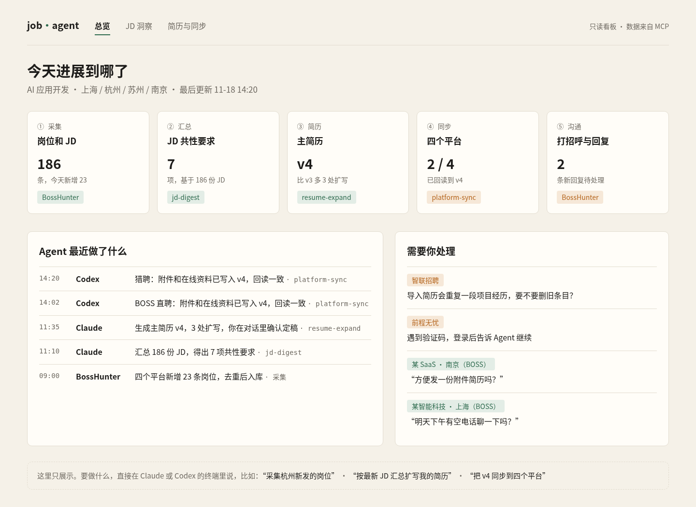
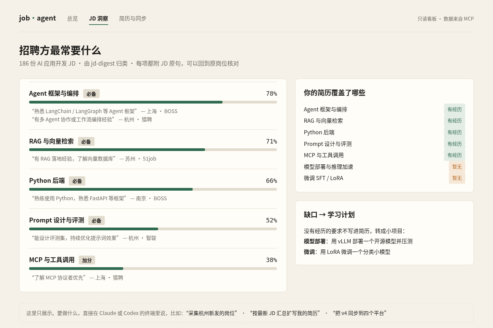
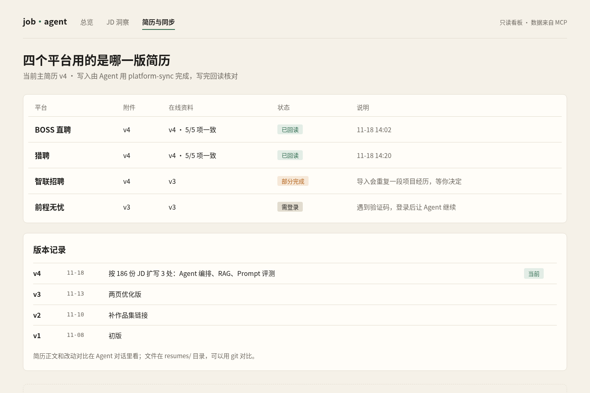

# job-agent 设计文档

> 本文主体保留 11-18 的 BossHunter 适配器设计作为历史背景。11-26 当前实现以 [ARCHITECTURE.md](ARCHITECTURE.md) 和 Issue #1 的架构评论为准：own 模式使用自有采集、评分、投递和监听，无需 BossHunter；评分经明确授权后调用配置的模型，结果写唯一 SQLite。下面关于不调用模型、依赖 BossHunter 和不自建岗位库的表述只适用于早期方案。

原则：**做减法、功能全、通用。** 已有的直接用，只补缺的部分。

## 目标

让求职者（任何岗位方向）花最少的时间拿到对口面试。

**MCP 的目标：给 Agent（Claude、Codex 等）足够多的上下文。** Agent 做判断前要知道四件事：我是谁、市场要什么、我做过什么、结果怎样。MCP 负责回答这四件事，判断和写作交给 Agent 和技能。

五步一个都不少：

| 步骤 | 谁来做 | 我们要新做的 |
| --- | --- | --- |
| ① 采集岗位和 JD | BossHunter（四个平台，去重） | 无 |
| ② JD 汇总 | 技能 `jd-digest` | 技能 + MCP 工具 `jd_requirements` |
| ③ 扩写主简历 | 技能 `resume-expand`，只用已有经历 | 技能 + 简历版本工具 |
| ④ 同步四个平台 | 技能 `platform-sync`（已有，bmdy6/skill-resume-platform-sync），由带浏览器的 Agent 执行 | 同步记录工具 |
| ⑤ 打招呼 + 回复 | 开场白：AI 拟、BossHunter 人工确认后发送。回复：Agent 读聊天页，AI 拟回复，用户点链接进去复制发送 | 投递记录、草稿、带链接的待办 |
| ⑥ 面试和复盘 | 技能 `interview-prep`：面试前准备、面试后复盘 | 投递记录里的面试事件 |

## 结构

```
BossHunter（上游原样安装，不 fork、不改代码）
  采集 · 评分 · 打招呼 · 回复监控 · 岗位和聊天页面
        ↑ 本机 HTTP 接口（127.0.0.1:8686，/api/agent/*）
job-agent（本仓库）
  ├─ mcp/      一个 MCP Server（stdio），在已有的 bosshunter-mcp 上扩展
  ├─ skills/   jd-digest · resume-expand · platform-sync
  └─ web/      只读看板（总览 · JD 洞察 · 简历与同步）
用户资料目录（不进仓库）
  ├─ config.yaml        模式、每日/每周上限、冲刺线、浏览器 CDP、BossHunter 配置和数据库路径（城市、薪资等以 BossHunter 为准）
  ├─ experience/        经历素材库，一段经历一个 md（项目细节、指标、做过的事）
  ├─ resumes/           v1.md v2.md …（版本就是文件）
  ├─ applications.jsonl 投递记录：一个事件一行（打招呼、对方回复、要简历、约面、面试、结果）
  ├─ drafts.jsonl       AI 拟的开场白和回复草稿
  ├─ companies/         公司信息缓存，一家一个文件（Agent 查到后存，下次直接用）
  ├─ sync-log.jsonl     每个平台每次同步的回读结果
  └─ activity.jsonl     MCP 调用记录（给看板的“Agent 最近做了什么”）
```

分工原则：**MCP 只提供数据和动作，判断交给技能。** MCP 不写死技能词表，也不调用模型。

### 数据来源（11-18 实测）

- BossHunter 桌面 App 的库：`~/Library/Application Support/BossHunter-<用户名>/data/bosshunter.db`，360 个岗位、四个平台、358 个有 JD、315 家公司。源码目录里的 `data/bosshunter.db` 只有 57 个 BOSS 岗位，是另一份。
- 8686 接口读到的是当时启动的那份。config 里写明用哪份（`bosshunter.db_path`），`status` 返回实际连的是哪份，避免读错。
- BossHunter 库里**没有打招呼和回复记录**（`history` 只有删除岗位这类操作）。所以投递记录、漏斗、回复都由 job-agent 自己记。
- 公司信息：公司名、薪资、外包识别（`outsourcing_level`）都有；HR 姓名/职位 135 条、活跃度 102 条；**公司规模和行业只有 33 条**（主要是 51job）。缺的由 Agent 按需补，见「公司信息」。
- 每个岗位都有 `url`（岗位详情页）。聊天页链接由 Agent 读聊天页时取当前页面地址，记进投递记录。

## 被删掉的东西（和为什么删）

- 搬入 BossHunter 代码：它已经有对外接口，直接调用就行，还能跟着上游升级。
- 自建采集器和开场白生成：BossHunter 都有。
- 自建岗位库、打招呼和回复页面：BossHunter 的工作台都有。
- 页面上的操作按钮：操作都在 Agent 对话里做，页面只读。
- 技能词表配置：写死就不通用了，归类交给 `jd-digest`。
- 数据库：简历版本用文件，同步记录用 jsonl。

只有 BossHunter 的接口缺我们必需的能力时，才在 fork（bmdy6/BossHunter）里补，并向上游提 PR。

## MCP 工具

沿用 bosshunter-mcp 的：`status` `search_jobs` `get_job` `check_collection` `start_collection` `preview_scoring` `start_scoring` `scoring_runs`

新增以下几组：

| 工具 | 说明 |
| --- | --- |
| `jd_requirements(filter)` | 批量返回 JD 里「任职要求」部分的原句，带 job_id、城市、平台，给 `jd-digest` 用 |
| `resume_list` / `resume_get(version)` / `resume_save(md, notes)` / `resume_set_current(version)` | 主简历版本 |
| `sync_record(platform, version, result)` / `sync_status()` | 记录和读取四个平台的同步回读结果 |
| `briefing(job_id?)` | **总入口**。不传：个人条件、当前简历版本、漏斗、今天剩余打招呼次数、带链接的待办。传岗位：JD、能对上的经历、这家公司以前联系过没有、是否命中排除条件、岗位链接和聊天链接 |
| `profile()` | 读 BossHunter 配置（城市、关键词、薪资、屏蔽公司、排除条件、评分用的简历），加上 job-agent 自己的模式和上限 |
| `experience_list` / `experience_get(id)` / `experience_add(md)` | 经历素材库。扩写缺素材时，Agent 先问用户，再用 `experience_add` 记下 |
| `log_event(job_id, event, resume_version?, draft_id?, chat_url?, note?)` | 记一条投递事件：greeted / replied / resume_requested / interview_scheduled / interviewed / offer / rejected |
| `company_history(company)` | 这家公司（名称归一化后）以前的所有事件，用来避免重复打招呼 |
| `funnel(group_by?)` | 按简历版本、平台、开场白分组的回复率、约面率 |
| `draft_save(job_id, kind, text)` / `drafts(status?)` | 保存 AI 拟的开场白（greeting）或回复（reply）；列出待发草稿，每条带岗位链接和聊天链接 |
| `company_get(company)` / `company_save(company, md)` | 公司信息缓存：规模、融资阶段、行业、介绍、来源链接和查询时间。MCP 只存取，不联网 |
| `setup_check()` | 新用户上手：列出还缺什么（config、简历、经历、BossHunter 服务和库、浏览器 CDP） |
| `resume_import(path)` | PDF / Word 转成文字（pdftotext 等），Agent 再整理成 md 用 `resume_save` 存 |

## 技能

- `jd-digest`：把要求原句归成技能项，统计比例，区分必备、加分和推断，每项保留原句。
- `resume-expand`：按共性要求扩写主简历。只改写真实经历，不新增项目和指标；每处改动输出「原文｜扩写后｜依据｜对应经历」；没有对应经历的要求只进学习计划。
- `platform-sync`：主简历写入四个平台（附件 + 在线资料），写完回读，结果用 `sync_record` 记下。
- `reply-assist`：Agent 用浏览器读各平台聊天页，把新回复用 `log_event` 记下并分类（要简历 / 约面 / 拒绝 / 提问），再拟回复用 `draft_save` 存。**回复不自动发**：用户点链接进聊天页，复制草稿发送。
- `interview-prep`：约面后用 `briefing(job_id)` 准备（公司、JD、对应经历、可能的问题）；面试后复盘，暴露的缺口进学习计划和经历库。

### 开场白写法

三段：固定的一句自我介绍 + **一句针对这个岗位的话** + 一句收尾。针对岗位的那句从 JD 里挑一条最看重的要求，对上一段真实经历（来自经历库），比如“看到贵司要 RAG 落地经验，我做过 XX，上线后 XX”。公司信息最多加半句。

- 素材来自 `briefing(job_id)`（JD + 能对上的经历），可参考 BossHunter 已有的 `greeting_original` / `greeting_optimized`。
- 发送方式和回复一样：AI 拟好用 `draft_save` 存，用户点链接进去复制发送。
- 开场白由 BossHunter 生成并保存在岗位上（`greeting_*` 字段）；`log_event` 记下写法（`variant`：generic / tailored），`funnel` 按写法看回复率。

### 公司信息

按需补，不批量补：只在打招呼前或约面后才查，省时间也少触发风控。

1. 先 `company_get`，有缓存就用。
2. 没有：Agent 用浏览器打开平台上的公司主页（BOSS 公司页有规模、融资阶段、行业、介绍），或上网搜。
3. 查到后 `company_save`，记来源链接和查询时间。

用途：筛掉外包和不合适的规模（结合 `outsourcing_level` 和 config 排除条件）；面试准备。

### 模式：练习 / 求职

模式是一组预设配置，在 config.yaml 里切换（`mode: practice | job`），技能按模式决定投哪些、怎么写。

| | 练习模式 | 求职模式 |
| --- | --- | --- |
| 投哪些 | 除硬性排除外都投（含外包、低分、冲刺岗） | 只投 BossHunter 通过的（ready） |
| 开场白 | 模板 + 一句针对 JD | A 档（80+）定制一句 |
| 查公司 | 不查 | A 档和约面的公司查（Agent 调搜索 MCP，如 research-mcp，结果 `company_save`） |
| 约面顺序 | 来了就面 | 练手的先面，想去的往后排 |

两种模式都不放开：硬性排除行业（如币圈、灰产）、薪资下限、同公司不重复、每日打招呼上限。练习模式另有每周面试上限（`practice.max_interviews_per_week`）。

薪资只设下限。比当前高很多的不排除，标为「冲刺」，排在最后打。外包不排除，只降低顺序。

### BossHunter 已有的，不重做（11-18 核对上游文档）

- **Agent 接口**（`/api/agent/*`）：`onboarding` 新用户缺什么、`config/preview` → `config/apply`（confirm）改偏好、`tasks` 启动 collect / monitor / full、`evaluations` 让本机 Agent 自己评分并写招呼语（不需要 AI Key）。
- **招呼语**：按 JD 和简历生成，20–150 字、只写一个有事实依据的匹配点。这就是「开场白写法」里那一句，直接用它，不另做草稿。
- **发送**：BOSS 人工确认后低频发送（`throttle.daily_limit`、发送时段、随机间隔、发送前浏览）；智联、51job、猎聘只读，在原平台手动投，再回填「已发送」。**每日上限用 BossHunter 的 `throttle`，job-agent 不再做 `quota`。**
- **回复**：BOSS 有回复监听（`monitor`）、识别 HR 要简历并发送、跟进（`follow_up`）、未处理回复计数。自动回复默认关（`auto_reply_hr_questions: false`）。
- **面试准备**：岗位可导出 JD Markdown 或交给 Interview Sim。
- **重新评分**：`/api/scoring/start` 带 `force_rescore: true` 才会重评已有结果。

所以 job-agent 要补的只剩：经历库、公司信息缓存、跨平台的投递事件（尤其三个只读平台和面试之后的事）、漏斗、回复草稿（非 BOSS 平台和 BOSS 上需要人写的回复）、模式、`briefing` 汇总。`greet_queue` / `quota` / 开场白草稿去掉。

### 采集条件以 BossHunter 为准

城市、岗位关键词、薪资、屏蔽公司、排除条件都在 BossHunter 的 `config.yaml`（`profile` / `search`）里，采集和评分用的就是它。job-agent 不再自己存一份，`profile()` 直接读 BossHunter 的配置返回，只补 BossHunter 没有的（模式、每周面试上限、冲刺线）。改采集条件要用户确认后再改 BossHunter 配置。

### 快速入口：处处带链接

凡是要用户动手的地方都给链接，点一下就到：`briefing` 的待办、`drafts`、`company_history`、看板，每条都带岗位链接（`url`），有聊天的再带聊天链接（`chat_url`）。用户的动作只剩：点链接 → 复制草稿 → 发送。

## 页面：只读看板

系统是 MCP，活由 Agent 在终端对话里干：简历是 Agent 用 `resume-expand` 写的，改动对比在对话里看，你在对话里确认。页面只负责展示，**除了「复制草稿」和链接，没有任何操作按钮**，不在页面背后藏一个调模型的后台。页面也不展示简历正文。

三页，数据都从 MCP 和用户资料目录读：

| 页面 | 回答的问题 | 内容 |
| --- | --- | --- |
| 总览 | 今天进展到哪了 | 漏斗（打招呼 → 回复 → 约面）；今天剩余次数；需要你处理的事（每条带链接和草稿，可复制）；Agent 最近做了什么 |
| JD 洞察 | 招聘方最常要什么 | 共性要求和出现比例，每项附 JD 原句；简历覆盖了哪些；缺口转成学习计划 |
| 简历与同步 | 四个平台用的是哪一版 | 每个平台附件和在线资料的版本、回读状态；版本记录 |

每页底部提示：要做什么，直接在 Claude 或 Codex 的终端里说。岗位明细、打招呼和聊天仍在 BossHunter 的工作台看。





风格：纸色底、近黑文字、只用一个强调色（深绿）；正文 16px，标题直接是一个问题。图里的数据都是编的。

为了让看板能显示“Agent 最近做了什么”，MCP 的每次调用都记一行到 `activity.jsonl`（时间、调用方、工具、结果摘要）。

## 通用

- 方向、城市、平台、薪资底线、排除条件、每日上限、浏览器都在 config.yaml 里配置，没有写死“AI 应用开发”。
- 浏览器只要求支持 CDP，Ego Lite 和 Chrome 都可以。
- 技能和代码里不放任何个人信息。
- 不复制 BossHunter 代码，只调它的接口，所以本仓库以后可以公开（公开前再核对一遍它的许可证）。

## 阶段

- **v0**：把 bosshunter-mcp 搬进 mcp/，加上 `jd_requirements`；写 `jd-digest` 和 `resume-expand`；用真实 JD 跑通汇总和扩写；验证 Ego Lite 的 CDP。
- **v1**：`briefing`、`profile`、经历库、公司信息缓存、投递记录（`log_event` / `company_history` / `funnel` / `quota`）、草稿；简历版本和同步记录工具；`setup_check` / `resume_import`；`platform-sync` 接上 `sync_record`。
- **v2**：`reply-assist` 和 `interview-prep` 技能；只读看板；新回复推送到 TG。

## 边界

- 账号安全：开场白只能在 BossHunter 里人工确认后发送；回复由用户复制发送，Agent 只读聊天页不发消息；超过每日上限时 `quota` 提示停下；遇到验证码交给用户处理。
- 简历和 JD 会发给模型，但不进仓库、日志和示例。
- 不做：自动提交投递表单、绕过验证码、改账号的可见性设置。
